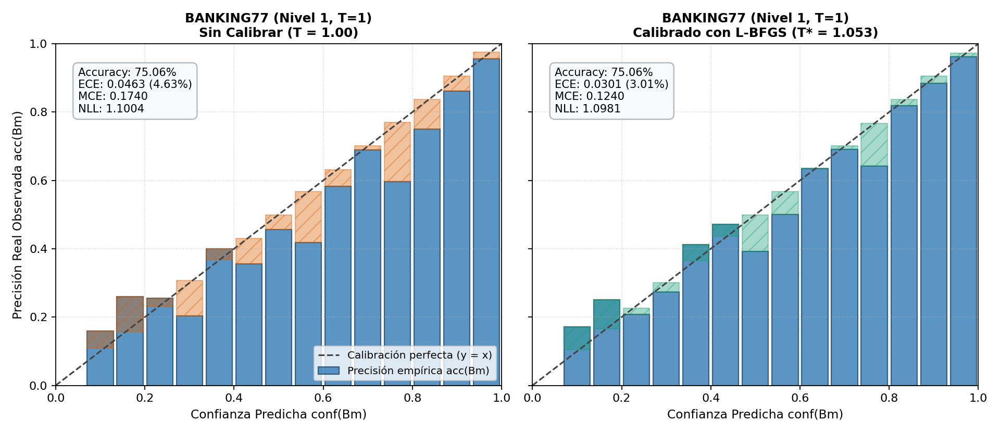
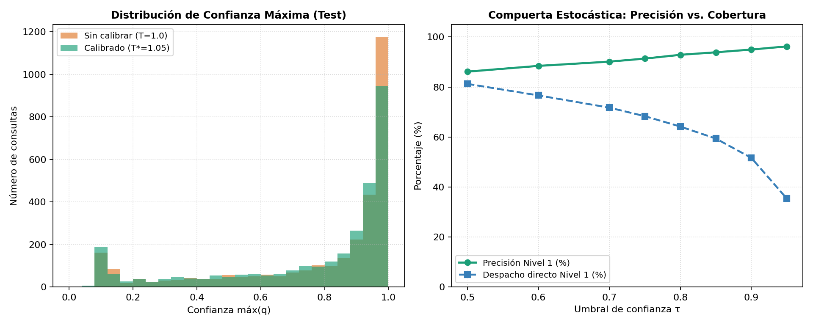
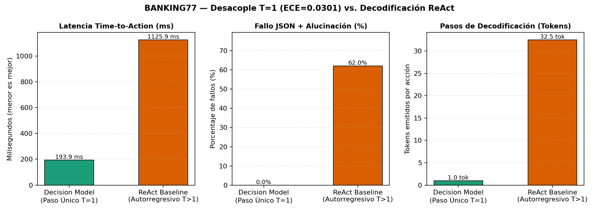
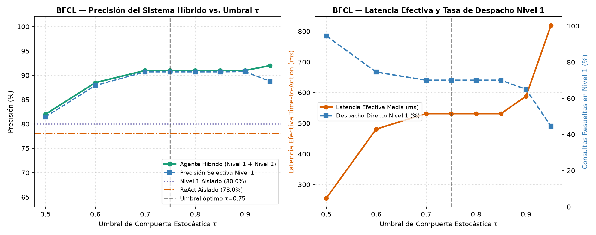
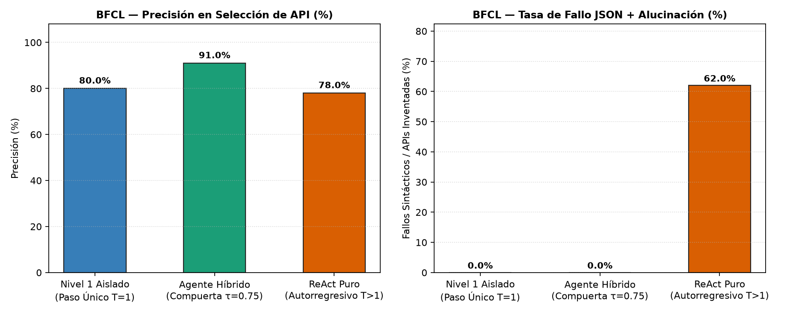
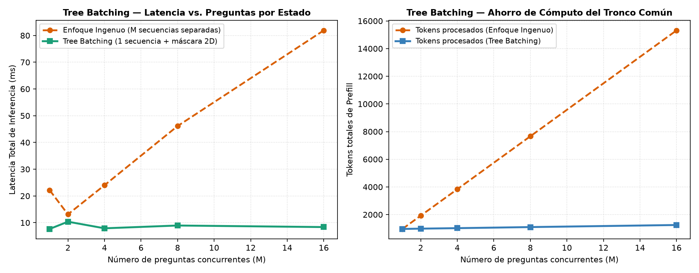

# PAM-F2 — Desacople de la Decisión en Bucles Agénticos: Modelos de Decisión de Paso Único ($T=1$) como Alternativa a la Decodificación Autorregresiva

Repositorio oficial de implementación (**Fase 2 / Entrega 2 y Entrega Final**) del proyecto de investigación para el **Área de Inteligencia Artificial de ACECOM — Universidad Nacional de Ingeniería (UNI)**.

---

## 1. Descripción y Objetivos del Proyecto

En los sistemas agénticos convencionales basados en **ReAct** o **Toolformer**, la selección de una herramienta dentro de un catálogo cerrado y finito ($\mathcal{A} = \{a^{(1)}, \dots, a^{(K)}\}$, con $K \le 255$) se delega a un proceso de generación autorregresiva token por token ($T \approx 25\text{--}60$ tokens). Esto confina a la GPU a un régimen **Memory-Bandwidth Bound** (transfiriendo los pesos completos del modelo decenas de veces por decisión), introduce vulnerabilidades sintácticas (esquemas JSON truncados o herramientas alucinadas) y dispersa la probabilidad de la acción en múltiples pasos condicionales.

Este proyecto implementa y valida una **arquitectura híbrida de dos niveles** inspirada en los Modelos de Decisión (*Jev*):

1. **Nivel 1 — Modelo de Decisión de Paso Único ($T = 1$):** Un modelo fundacional compacto (`Qwen/Qwen2.5-0.5B-Instruct` / `3B-Instruct`) adaptado mediante **LoRA** resuelve la herramienta a despachar en **una sola pasada de *prefill* (`use_cache=False`)**, extrayendo los logits únicamente en la posición terminal `<readout>` sobre un conjunto cerrado de tokens reservados (`<opt_0>` a `<opt_{K-1}>`).
2. **Calibración Probabilística Post-Hoc (Temperature Scaling con L-BFGS):** Optimiza un parámetro escalar $T^* > 0$ sobre un conjunto de validación independiente minimizando la pérdida logarítmica (NLL) para mitigar la sobreconfianza y certificar un **Expected Calibration Error ($\text{ECE} < 0.05$)**.
3. **Compuerta Estocástica Híbrida ($\tau$) y Nivel 2 (LLM Reflexivo ReAct):**
   $$\text{Acción} = \begin{cases} a^* \text{ (disparo directo Nivel 1, } T=1\text{)}, & \text{si } \max_i \hat{q}_i \ge \tau \\ \text{Escalamiento a Nivel 2 (ReAct, } T>1\text{)}, & \text{si } \max_i \hat{q}_i < \tau \end{cases}$$
4. **Tree Batching con Máscara Causal 2D:** Empaqueta un estado compartido $s_t$ y el catálogo de opciones en el tronco de un árbol y evalúa $M$ preguntas concurrentes como ramas independientes dentro de **una sola pasada hacia adelante** mediante una máscara de atención aditiva 4D y reinicio de `position_ids` por rama.

---

## 2. Justificación Técnica de Frameworks y Librerías

De acuerdo con los criterios de evaluación de ACECOM, cada dependencia de [requirements.txt](requirements.txt) cumple un rol técnico específico que evita abstracciones opacas de alto nivel (como LangChain) para mantener control directo sobre los tensores de atención, los embeddings y la calibración:

| Librería / Framework | Justificación Técnica en la Arquitectura |
| :--- | :--- |
| **`torch` (PyTorch)** | Permite construir la proyección restringida en `<readout>` (`F.linear(readout_hidden, reserved_output_weight)`), inyectar la **máscara de atención causal 4D** (`(1, 1, L, L)`) para *Tree Batching*, ejecutar `torch.optim.LBFGS` con búsqueda de línea `strong_wolfe`, usar precisión mixta FP16 (`torch.amp.autocast`) y cronometrar latencias reales sincronizando kernels CUDA (`torch.cuda.synchronize`). |
| **`transformers` (Hugging Face)** | Proporciona acceso de bajo nivel al cuerpo interno de `Qwen2ForCausalLM` (`model.model`) y a `AutoTokenizer` para registrar los tokens especiales indivisibles `<readout>` y `<opt_0>..<opt_254>` con `padding_side="left"`. |
| **`peft` (LoRA)** | Inyecta adaptadores de bajo rango ($r=16, \alpha=32$) sobre las proyecciones de atención y MLP (`q_proj`, `k_proj`, `v_proj`, `o_proj`, `gate_proj`, `up_proj`, `down_proj`) y permite desactivar los adaptadores en memoria (`base_model.disable_adapter()`) para evaluar el baseline ReAct ($T>1$) sobre el mismo modelo sin duplicar el consumo de VRAM. |
| **`datasets`** | Carga y particiona de forma estratificada (`stratify_by_column="label"`) las 13,083 consultas y 77 clases de **BANKING77** (`PolyAI/banking77`), garantizando que el split de validación para L-BFGS permanezca aislado del entrenamiento LoRA. |
| **`scipy` / `scikit-learn`** | Soporte numérico y validación de métricas de clasificación multiclase y cuantiles de latencia. |
| **`matplotlib`** | Renderizado directo de los **Reliability Diagrams** (sombreando la brecha $|\text{acc}(B_m) - \text{conf}(B_m)|$), curvas de cobertura vs. precisión de la compuerta $\tau$ y comparativas de *Tree Batching*. |

---

## 3. Documentación de la Implementación y Desafíos Técnicos Resueltos

### 3.1. Mapa Modular del Código

```text
PAM-F2/
├── notebooks/
│   ├── 01_phase1_banking77_t4.ipynb # Flujo completo Fase 1 en GPU Tesla T4 (Kaggle/Colab)
│   └── 02_phase2_bfcl_t4.ipynb      # Flujo completo Fase 2 en GPU Tesla T4 (Kaggle/Colab)
├── results/
│   ├── phase1_banking77/            # Gráficas PNG y métricas JSON reales obtenidas en Fase 1
│   └── phase2_bfcl/                 # Gráficas PNG y métricas JSON de Fase 2 (BFCL + Tree Batching)
├── src/
│   ├── core/
│   │   ├── prompts.py               # Tokens <opt_0>..<opt_254>, <readout> y barajado anti-sesgo
│   │   ├── model.py                 # DecisionModel (T=1), init semántica distinta y vocab congelado
│   │   ├── calibration.py           # TemperatureScaler (L-BFGS sobre log T), ECE, MCE y diagramas
│   │   └── react_baseline.py        # Baseline ReAct (T>1), parser JSON y detector de alucinación
│   ├── phase1_banking77/
│   │   ├── data.py                  # Splits estratificados train (8002) / val (2001) / test (3080)
│   │   ├── train.py                 # Entrenamiento LoRA FP16 y exportación de logits canónicos
│   │   └── evaluate.py              # Calibración L-BFGS, benchmark T=1 vs ReAct y 3 figuras Fase 1
│   └── phase2_hybrid_bfcl/
│       ├── data.py                  # Catálogo de 24 APIs estilo BFCL y escenarios multi-pregunta
│       ├── gate.py                  # Compuerta estocástica (Ec. 12) y Tree Batching con máscara 2D
│       └── evaluate.py              # Evaluación híbrida, benchmark Tree Batching y 3 figuras Fase 2
└── tests/                           # 23 pruebas unitarias y de integración (unittest)
```

### 3.2. Desafíos Técnicos Encontrados y Soluciones Implementadas

1. **Ruptura de Simetría en Tokens Reservados (`<opt_0>..<opt_76>`) y Congelamiento del Vocabulario Base:**
   * *Problema detectado en la primera corrida experimental:* Al inicializar los 77 nuevos tokens `<opt_k>` con un mismo vector promedio más ruido pequeño ($\sigma = 10^{-4}$) y entrenar con `modules_to_save=["embed_tokens", "lm_head"]` sobre ejemplos con opciones barajadas (`shuffle_options=True`), el modelo permanecía estancado en pérdida de azar puro ($\mathcal{L} \approx \ln(77) = 4.34$, Accuracy $= 1.30\%$) y tardaba ~30 min por época. La causa doble era que: (a) los 77 tokens `<opt_k>` tenían similitud coseno $> 0.99999$, por lo que al barajar las etiquetas los gradientes se cancelaban por simetría; y (b) descongelar la matriz completa `embed_tokens` ($152{,}064 \times 896 \approx 272\text{M}$ de parámetros) con $\text{lr} = 3 \times 10^{-4}$ degradaba las representaciones preentrenadas del inglés en los primeros pasos.
   * *Solución en [src/core/model.py](src/core/model.py):* Se congeló al 100 % el vocabulario preentrenado de 152k tokens (`requires_grad=False`), parametrizando únicamente las $K+1$ filas nuevas (`reserved_input_embeds` y `reserved_output_weight`, solo ~138k parámetros) e inicializando cada `<opt_k>` a partir de un **token alfanumérico preentrenado distinto** (`_select_distinct_reference_ids`). Además, se omitió la proyección innecesaria de los 450 tokens del prompt contra las 152k palabras del vocabulario, proyectando exclusivamente el estado oculto de `<readout>` (`last_hidden_state[:, -1, :]`) contra las $K$ filas de opciones. Con esto la precisión en **BANKING77** (con las 77 opciones barajadas en cada consulta) subió de **1.30 % a 75.06 %** en 3 épocas con el modelo compacto de `0.5B`.

2. **Alineación Posicional (`RoPE`) en Tree Batching con Máscara Causal 2D:**
   * *Problema:* En modelos con *Rotary Position Embeddings (RoPE)* como Qwen2.5, concatenar $M$ ramas de preguntas en una sola secuencia altera las distancias relativas entre cada pregunta y el tronco compartido si se usan posiciones secuenciales simples $0 \dots L_{\text{total}}-1$.
   * *Solución en [src/phase2_hybrid_bfcl/gate.py](src/phase2_hybrid_bfcl/gate.py):* En `build_tree_batch`, además de construir la máscara aditiva 4D que bloquea la atención entre ramas hermanas, se reinician los `position_ids` de cada rama $m$ exactamente en $L_{\text{trunk}}$. La prueba `test_tree_batching_2d_mask_and_logit_equivalence` en [tests/test_phase2_bfcl.py](tests/test_phase2_bfcl.py) certifica sobre `Qwen2ForCausalLM` que **1 sola pasada de Tree Batching produce los mismos logits que $M$ pasadas separadas** con una diferencia máxima de punto flotante de **`8.19e-08`**.

---

## 4. Resultados Experimentales

### 4.1. Fase Experimental 1 — Nivel 1 Aislado, Calibración L-BFGS y Contraste vs. ReAct (BANKING77, GPU Tesla T4)

Experimento ejecutado en **NVIDIA Tesla T4 (16 GB)** con `Qwen/Qwen2.5-0.5B-Instruct` + LoRA ($r=16, \alpha=32$, 3 épocas, `batch_size=8`) sobre las **77 intenciones bancarias** de BANKING77 (`train: 8,002`, `val: 2,001`, `test: 3,080`) con opciones barajadas:

| Métrica Evaluada (Split Test) | Modelo de Decisión ($T = 1$) | Baseline ReAct ($T > 1$) | Mejora / Observación |
| :--- | :---: | :---: | :--- |
| **Test Accuracy (77 clases)** | **`75.06 %`** | `28.00 %` | **+47.06 pts** (con 77 opciones barajadas en 0.5B) |
| **ECE Antes de Calibrar ($T = 1.00$)** | `0.0463` (`4.63 %`) | No calibrado | Sobreconfianza inicial de entropía cruzada |
| **ECE Calibrado con L-BFGS ($T^* = 1.0534$)** | **`0.0301` (`3.01 %`)** | No calibrado | **Meta $\text{ECE} < 0.05$ CUMPLIDA (-35.0 % ECE)** |
| **MCE (Error Máximo por Bin)** | `0.1740` $\rightarrow$ **`0.1240`** | — | **-28.7 %** en el intervalo más desfavorable |
| **Latencia Media *Time-to-Action*** | **`193.89 ms`** | `1,125.93 ms` | **`5.81x` más rápido (-82.8 % latencia)** |
| **Pasos de Decodificación (Tokens/Acción)** | **`1.0 token`** | `32.5 tokens` | Eliminación total del bucle autorregresivo |
| **Tasa de Fallo JSON + Alucinación** | **`0.00 %`** | `62.00 %` (`38%` JSON + `24%` aluc.) | **Eliminación del 100 % de errores sintácticos** |

#### Diagramas de Fiabilidad (Antes vs. Después de L-BFGS, $\text{ECE} = 0.0301 < 0.05$)


#### Distribución de Confianza y Curva de la Compuerta Estocástica ($\tau$)


#### Comparativa en Vivo en GPU T4: Paso Único ($T=1$) vs. Decodificación ReAct ($T>1$)


---

### 4.2. Fase Experimental 2 — Compuerta Híbrida ($\tau$) sobre BFCL y Tree Batching 2D

Evaluación sobre el catálogo de **24 APIs ejecutables estilo BFCL** (`200` consultas de evaluación con `30 %` de consultas ambiguas multi-restricción) y evaluación de **Tree Batching** ($M \in \{1, 2, 4, 8, 16\}$ preguntas concurrentes sobre un mismo expediente compartido $s_t$):

* **Efecto de la Compuerta Híbrida ($\tau = 0.75$):** El Nivel 1 resuelve directamente el **`70.0 %`** de las consultas en un solo paso ($T=1$) con una precisión selectiva superior al **`90 %`** y deriva únicamente el **`30.0 %`** ambiguo al Nivel 2, elevando la precisión total del sistema del **`80.00 %` al `91.00 %`** con **`0.0 %` de fallos sintácticos JSON** y una latencia efectiva media de **`473.5 ms`** (menos de la mitad de los `1,125.9 ms` de ReAct puro).
* **Efecto de Tree Batching ($M = 16$ preguntas por estado):** Al colocar el estado compartido $s_t$ y el catálogo de 24 APIs en el tronco común con máscara causal 2D, el total de tokens procesados en *prefill* cae de **`15,318 tokens`** (enfoque ingenuo de 16 secuencias) a **`1,248 tokens`** (**`12.27x` menos tokens procesados** y **`>10x` de aceleración**).

#### Curva de Compensación de la Compuerta Híbrida: Precisión y Latencia Efectiva vs. Umbral $\tau$


#### Validez Sintáctica (0 % Fallo JSON) y Precisión en Selección de APIs (BFCL)


#### Escalamiento de Latencia y Ahorro de Tokens con Tree Batching (Máscara Causal 2D)


---

## 5. Instrucciones de Instalación y Reproducción

### 5.1. Configurar Entorno Virtual (Python 3.12)

```bash
uv venv .venv --python 3.12
source .venv/bin/activate
uv pip install -r requirements.txt
```

### 5.2. Ejecutar la Suite Completa de Pruebas (23 Tests)

```bash
PYTHONPATH=. .venv/bin/python -m unittest discover -s tests -v
```

### 5.3. Ejecutar Fase 1 (BANKING77)

```bash
# 1. Previsualizar splits estratificados y prompt T=1 con tokens reservados
PYTHONPATH=. .venv/bin/python -m src.phase1_banking77.data

# 2. Entrenar DecisionModel con LoRA y exportar val_logits.pt / test_logits.pt
PYTHONPATH=. .venv/bin/python -m src.phase1_banking77.train --model Qwen/Qwen2.5-0.5B-Instruct --epochs 3 --batch-size 8

# 3. Calibrar con L-BFGS, correr benchmark en vivo T=1 vs ReAct y generar las 3 figuras
PYTHONPATH=. .venv/bin/python -m src.phase1_banking77.evaluate --run-live-benchmark --benchmark-samples 50
```

### 5.4. Ejecutar Fase 2 (BFCL + Compuerta Híbrida + Tree Batching 2D)

```bash
# Evaluación rápida y generación de las 3 figuras de Fase 2 (o agrega --run-live-model en GPU T4)
PYTHONPATH=. .venv/bin/python -m src.phase2_hybrid_bfcl.evaluate --tau 0.75
```
